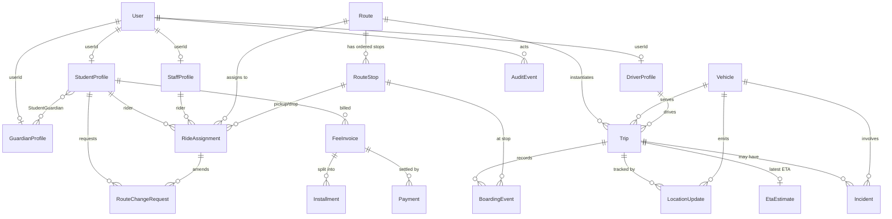

# ViaFast — Canonical Domain Model

Status: **Proposed contract** (design phase). Not yet implemented in any backend, Prisma schema, or Flutter client.
Scope target: a single university campus transport operation with **1–10 buses**.
Companion docs: [`api-contract.md`](./api-contract.md), [`realtime-contract.md`](./realtime-contract.md), [`data-integrity-audit.md`](./data-integrity-audit.md), [`architecture-decisions.md`](./architecture-decisions.md).

This document is the **single source of truth for entity names and fields**. A backend engineer (Node + TypeScript + Prisma + PostgreSQL) and a Flutter engineer must be able to implement against it without guessing names.

---

## 0. Global conventions

| Concern | Decision |
|---|---|
| Primary keys | Opaque **ULID** strings (26 chars, lexicographically time-ordered), e.g. `01J9ZK...`. Column name is always `id`. |
| Business keys | Registration number, phone, plate, licence, route code are **UNIQUE attributes**, never foreign keys. See ADR‑002. |
| JSON wire naming | **camelCase** (matches existing React code and Flutter `json_serializable`). |
| DB column naming | **snake_case**; Prisma maps `@map`/`@relation`. |
| Timestamps | **ISO‑8601 UTC** on the wire (`2026-10-11T07:15:00Z`); `timestamptz` in Postgres. Never display strings like `"7:15 AM"` or `"10 mins ago"`. See ADR‑005. |
| Money | **Integer PKR** (`amountPkr`). No floats. Balance/status are **derived**, never stored redundantly. See ADR‑006. |
| Coordinates | `latitude` / `longitude` as `double precision` (WGS‑84). Field names are spelled out on the wire (existing code mixes `lat`/`lng`). |
| Soft delete | `deletedAt timestamptz NULL` only where history matters (Route, Vehicle, Assignment). Hard delete elsewhere. |
| Enums | UPPER_SNAKE on the wire (e.g. `IN_PROGRESS`). Existing code uses Title Case / camelCase inconsistently; the audit maps old→new. |

> **Assumption (needs approval):** term/semester is modelled as a `Term` entity so assignments, invoices, and trips can be scoped per term. The existing app has only a free-text `semester` string on `Student`. If the deployment is single-term and never needs historical terms, `Term` can be collapsed to a string label — flagged in ADR‑011.

---

## 1. Identity, roles, and permissions

The existing app has **no `User` entity** — identity is smeared across `Student`, `Driver`, and a mock role picker in `App.tsx`. The canonical model separates **authentication identity** (`User`) from **role profiles**.

### 1.1 `User`
Authentication principal. One per human login.

| Field | Type | Req | Notes |
|---|---|---|---|
| `id` | ULID | ✓ | PK |
| `email` | string | ✓ | UNIQUE, lowercased, verified login identifier |
| `phoneE164` | string | – | UNIQUE when present; alternate identifier / OTP channel |
| `passwordHash` | string | – | argon2id; NULL for OTP-only accounts. **Never** plaintext. |
| `primaryRole` | `UserRole` | ✓ | Governs default landing experience |
| `status` | `UserStatus` | ✓ | Lifecycle |
| `lastLoginAt` | timestamptz | – | |
| `createdAt` / `updatedAt` | timestamptz | ✓ | |

- Indexes: `UNIQUE(email)`, `UNIQUE(phoneE164)` (partial, where not null), `INDEX(primaryRole, status)`.
- `UserRole` = `STUDENT | PARENT | DRIVER | ADMIN | STAFF`. **`landing` is removed** — it is a UI screen, not an identity (existing `Role` type conflates them).
- `UserStatus` = `INVITED | ACTIVE | SUSPENDED | DEACTIVATED`.
- Transitions: `INVITED → ACTIVE → SUSPENDED → ACTIVE`; `ACTIVE/SUSPENDED → DEACTIVATED` (terminal).

A `User` links to **at most one** role profile (`StudentProfile`, `DriverProfile`, `GuardianProfile`, `StaffProfile`) via that profile's `userId`. An `ADMIN`/`STAFF` user may have no rider profile.

### 1.2 Roles & permissions (static map, not a table)
For a 1–10 bus deployment, permissions are a **static code-level map**, not a DB-driven RBAC engine (ADR‑003). Roles grant coarse permissions; **resource-level checks** (this parent ↔ this student, this driver ↔ this trip) are enforced in the service layer on every request.

| Permission | STUDENT | PARENT | DRIVER | ADMIN | STAFF |
|---|:--:|:--:|:--:|:--:|:--:|
| `read:own-ride` | ✓ | ✓ (linked) | – | ✓ | ✓ (own pass) |
| `read:assigned-trip` | – | – | ✓ | ✓ | – |
| `write:boarding-event` | – | – | ✓ | ✓ | – |
| `write:incident` | – | – | ✓ | ✓ | – |
| `read:own-fee` / `write:own-payment` | ✓ | ✓ (linked) | – | ✓ | – |
| `write:route-change-request` | ✓ | ✓ (linked) | – | ✓ | – |
| `read:fleet` / `write:fleet` | – | – | – | ✓ | – |
| `write:route` / `write:stop` | – | – | – | ✓ | – |
| `write:assignment` | – | – | – | ✓ | – |
| `read:reports` | – | – | – | ✓ | – |
| `read:audit-log` | – | – | – | ✓ | – |

> **Rule (non-negotiable):** authorization is **always re-checked server-side** against the resource, never inferred from the client route guard or the `primaryRole` claim alone. See [`api-contract.md`](./api-contract.md) §2 and ADR‑008.

### 1.3 `GuardianProfile` (parent/guardian)
First-class identity for a guardian. Replaces `Student.parentName` / `Student.parentPhone` strings.

| Field | Type | Req | Notes |
|---|---|---|---|
| `id` | ULID | ✓ | PK |
| `userId` | ULID | ✓ | UNIQUE FK → `User` |
| `fullName` | string | ✓ | |
| `phoneE164` | string | – | Contact; **not** a link key (see §1.4) |

### 1.4 `StudentGuardian` (link)
M:N relationship — a student may have multiple guardians; a guardian may have multiple children. Replaces the `students.filter(s => s.parentPhone === phone)` linkage in `ParentApp.tsx`.

| Field | Type | Req | Notes |
|---|---|---|---|
| `id` | ULID | ✓ | PK |
| `studentId` | ULID | ✓ | FK → `StudentProfile` |
| `guardianId` | ULID | ✓ | FK → `GuardianProfile` |
| `relationship` | string | – | e.g. `Father`, `Mother`, `Guardian` |
| `isPrimary` | bool | ✓ | Default false; one primary per student |
| `canTrack` | bool | ✓ | Default true; authorizes live-tracking visibility |
| `createdAt` | timestamptz | ✓ | |

- `UNIQUE(studentId, guardianId)`. Partial unique on `(studentId) WHERE isPrimary`.

---

## 2. People (riders & crew)

### 2.1 `StudentProfile`
| Field | Type | Req | Notes |
|---|---|---|---|
| `id` | ULID | ✓ | PK — **the** student FK target everywhere |
| `userId` | ULID | – | UNIQUE FK → `User`; NULL for a rider without a login (e.g. young student, guardian-managed) |
| `studentNumber` | string | ✓ | UNIQUE business key (e.g. `22F-3891`). Display only — never an FK. |
| `rollNumber` | string | – | Departmental roll (e.g. `CS-2023-104`) |
| `fullName` | string | ✓ | |
| `department` | string | ✓ | |
| `semester` | string | ✓ | Free label (canonical `Term` linkage is via assignments, not here) |
| `avatarUrl` | string | – | |
| `enrollmentStatus` | `EnrollmentStatus` | ✓ | |
| `createdAt` / `updatedAt` | timestamptz | ✓ | |

- `EnrollmentStatus` = `PENDING | APPROVED | ACTIVE | SUSPENDED | WITHDRAWN`.
  - Existing `RegistrationStatus` had both `Approved` and `Active` with no distinction. Canonical: `APPROVED` = seat granted, not yet riding; `ACTIVE` = riding in the current term. Transition `PENDING → APPROVED → ACTIVE`; `PENDING/APPROVED → (REJECTED→)WITHDRAWN`; `ACTIVE → SUSPENDED → ACTIVE`. **`REJECTED` is represented as `WITHDRAWN` + an audit reason** to avoid two near-synonymous terminal states (flagged in ADR‑011).
- **Removed from `Student`:** `routeId`, `pickupStopId`, `dropStopId` (→ `RideAssignment`), `journeyStatus` (→ derived from `BoardingEvent`), `parentName`/`parentPhone` (→ `GuardianProfile`/`StudentGuardian`), and **all four fee fields** `feePaid`/`totalFee`/`feeStatus`/`feeAmount` (→ §6 billing). `isStaff` → `StaffProfile`.
- Indexes: `UNIQUE(studentNumber)`, `UNIQUE(userId)`, `INDEX(enrollmentStatus)`.

### 2.2 `DriverProfile`
| Field | Type | Req | Notes |
|---|---|---|---|
| `id` | ULID | ✓ | PK |
| `userId` | ULID | – | UNIQUE FK → `User` |
| `fullName` | string | ✓ | |
| `phoneE164` | string | ✓ | Contact |
| `licenseNumber` | string | ✓ | UNIQUE |
| `licenseClass` | string | – | e.g. `HTV`, `PSV` (existing data encodes this in the number) |
| `ratingAvg` | number | – | 0.0–5.0, derived/cached from ratings |
| `experienceYears` | int | – | |
| `employmentStatus` | `DriverStatus` | ✓ | |
| `avatarUrl` | string | – | |

- `DriverStatus` = `ACTIVE | ON_LEAVE | TERMINATED`. **Removed** `On Trip`/`Ready`/`Standby`/`Off Duty` from the driver record — duty state is a property of the **Trip assignment**, not the person (existing `Driver.status` mixed employment with live duty).
- **Removed:** `assignedVehicleId`, `assignedRouteId` (→ `Trip.vehicleId`/`Trip.driverId`). This kills the triple-duplicated assignment described in the audit.
- Indexes: `UNIQUE(licenseNumber)`, `UNIQUE(userId)`.

### 2.3 `StaffProfile` (faculty / transport-eligible staff riders)
Optional rider type for one-off or term passes (existing `StaffPassenger`). Kept **separate** from `StudentProfile` (existing code injected staff into the `students` array — see audit).

| Field | Type | Req | Notes |
|---|---|---|---|
| `id` | ULID | ✓ | PK |
| `userId` | ULID | – | UNIQUE FK → `User` |
| `staffNumber` | string | ✓ | UNIQUE (e.g. `EMP-401`) |
| `fullName` | string | ✓ | |
| `department` | string | ✓ | |
| `passType` | `StaffPassType` | ✓ | `SINGLE_TRIP | TERM` |
| `validFrom` / `validTo` | date | – | For `TERM` passes |

- A staff rider books a specific run via `RideAssignment` (with `riderType=STAFF`) or a `StaffRideBooking` for single trips. **Assumption (ADR‑011):** single-trip faculty rides are rare enough to model as a lightweight `StaffRideBooking` (tripId + staffProfileId + stopId + status) rather than a full assignment.

---

## 3. Fleet & network

### 3.1 `Vehicle`
| Field | Type | Req | Notes |
|---|---|---|---|
| `id` | ULID | ✓ | PK |
| `plateNumber` | string | ✓ | UNIQUE (e.g. `Coaster # 1987`, `Bus # BA-9757`) |
| `vehicleType` | `VehicleType` | ✓ | `COASTER | BUS` |
| `seatCapacity` | int | ✓ | > 0 (30 / 40 / 50) |
| `model` | string | – | |
| `status` | `VehicleStatus` | ✓ | Lifecycle only |
| `deletedAt` | timestamptz | – | |

- `VehicleStatus` = `IN_SERVICE | MAINTENANCE | RESERVE | RETIRED`. **Removed** `Active`/`Delayed` from the vehicle — "delayed" is a live **Trip** condition, "active" is whether it is currently assigned to a running trip (derived). Existing `Vehicle.status` mixed both (audit).
- **Removed:** `assignedRouteId`, `assignedDriverId` (→ `Trip`), `currentLat`, `currentLng` (→ `LocationUpdate`; a vehicle has no meaningful position without a trip), `fuelLevel` (→ optional telemetry in `LocationUpdate.fuelPercent`, not a vehicle attribute).
- Empty-string FK sentinels (`assignedRouteId: ''` on the reserve vehicle/driver) are **eliminated** — use NULL.
- Indexes: `UNIQUE(plateNumber)`, `INDEX(status)`.

### 3.2 `Route` (static corridor template)
| Field | Type | Req | Notes |
|---|---|---|---|
| `id` | ULID | ✓ | PK |
| `code` | string | ✓ | UNIQUE human code (e.g. `R1`); `routeNumber` becomes an int attribute if needed |
| `name` | string | ✓ | e.g. `Cantt & Askari Express` (drop the `Route N:` prefix duplication) |
| `colorHex` | string | ✓ | `#06b6d4` |
| `isActive` | bool | ✓ | Open for assignment |
| `deletedAt` | timestamptz | – | |

- **Removed from `TransportRoute`:** `busId`, `driverId` (→ `Trip`), `status` (a live trip property, not a template property), `direction` (a **Trip** property — the same corridor runs inbound and return), `morningStartTime`/`campusArrivalTime`/`totalDistanceKm` (→ derived from stops / `RouteSchedule`). This resolves the "route has a status but never moves" confusion.

### 3.3 `RouteStop` (ordered stops)
| Field | Type | Req | Notes |
|---|---|---|---|
| `id` | ULID | ✓ | PK — the stop FK target |
| `routeId` | ULID | ✓ | FK → `Route`, cascade |
| `sequence` | int | ✓ | 1-based order **within the inbound direction** |
| `name` | string | ✓ | |
| `latitude` / `longitude` | double | ✓ | |
| `distanceFromOriginKm` | number | ✓ | Cumulative from sequence 1 |
| `scheduledInboundTime` | time | – | HH:MM (24h) — replaces `morningTime` string |
| `scheduledReturnTime` | time | – | HH:MM (24h) — replaces `returnTime` string |

- `UNIQUE(routeId, sequence)`, `INDEX(routeId)`.
- **Direction & ordering (audit finding):** the return trip visits stops in **reverse sequence**. The canonical model stores **one** ordered stop list (inbound) and derives the return order by reversing it. Return times are stored per stop but must be monotonic in the *reversed* order; a validation rule enforces this. The existing data encodes both directions on one forward-ordered list with non-monotonic return times (Campus `sequence=N` has the earliest `returnTime`) — see audit §"Stop ordering".
- `demand` (existing per-stop student count) is **removed as a stored field** — it is a derived planning metric (count of active assignments whose `pickupStopId` = this stop). Storing it caused three conflicting load numbers (audit).

### 3.4 `RouteSchedule` (optional, term-scoped timings)
Only if a corridor's published timings change per term. For phase 1 the `scheduledInboundTime`/`scheduledReturnTime` on `RouteStop` are sufficient. **Assumption (ADR‑011):** defer `RouteSchedule`; revisit if the transport office needs date-effective timetables.

---

## 4. Assignment, trips, and journey events

### 4.1 `RideAssignment` (student ↔ route/stop, per term)
Replaces `Student.routeId/pickupStopId/dropStopId`. This is the authoritative "who rides what".

| Field | Type | Req | Notes |
|---|---|---|---|
| `id` | ULID | ✓ | PK |
| `riderType` | `RiderType` | ✓ | `STUDENT | STAFF` |
| `studentId` | ULID | cond | FK → `StudentProfile` when `riderType=STUDENT` |
| `staffProfileId` | ULID | cond | FK → `StaffProfile` when `riderType=STAFF` |
| `routeId` | ULID | ✓ | FK → `Route` |
| `pickupStopId` | ULID | ✓ | FK → `RouteStop` (must belong to `routeId`) |
| `dropStopId` | ULID | ✓ | FK → `RouteStop` (must belong to `routeId`) |
| `termId` | ULID | – | FK → `Term` (see ADR‑011) |
| `status` | `AssignmentStatus` | ✓ | |
| `effectiveFrom` / `effectiveTo` | date | – | |
| `createdAt` / `updatedAt` | timestamptz | ✓ | |

- `AssignmentStatus` = `ACTIVE | PAUSED | ENDED`.
- **Validation:** `pickupStopId.routeId == routeId == dropStopId.routeId`; `pickupStop.sequence < dropStop.sequence` for inbound. Enforced in the service layer + a DB trigger/check. This is the invariant the existing app never enforced.
- Indexes: `INDEX(routeId, status)`, `INDEX(studentId)`, partial `UNIQUE(studentId) WHERE status='ACTIVE' AND effectiveTo IS NULL` (one active assignment per student per term).

### 4.2 `Trip` (a concrete scheduled run)
Replaces `ActiveTrip`. One `Route` spawns many `Trip`s (one per service date × direction).

| Field | Type | Req | Notes |
|---|---|---|---|
| `id` | ULID | ✓ | PK |
| `routeId` | ULID | ✓ | FK → `Route` |
| `serviceDate` | date | ✓ | Calendar day of operation |
| `direction` | `TripDirection` | ✓ | `INBOUND | RETURN` (replaces `TripType morning/return`) |
| `vehicleId` | ULID | – | FK → `Vehicle`; the vehicle **assigned to this run** (single source of truth) |
| `driverId` | ULID | – | FK → `DriverProfile`; assigned driver for this run |
| `status` | `TripStatus` | ✓ | Lifecycle |
| `scheduledDepartureAt` | timestamptz | ✓ | |
| `scheduledArrivalAt` | timestamptz | ✓ | |
| `actualDepartureAt` | timestamptz | – | Set on `BOARDING`→`IN_PROGRESS` |
| `actualArrivalAt` | timestamptz | – | Set on `COMPLETED` |
| `delayMinutes` | int | ✓ | Default 0; **derived/cached** from ETA engine, not hand-edited |
| `currentStopSequence` | int | – | Last confirmed stop; derived from `LocationUpdate`/driver action |

- `UNIQUE(routeId, serviceDate, direction)` prevents duplicate runs.
- `TripStatus` = `SCHEDULED | BOARDING | IN_PROGRESS | COMPLETED | CANCELLED`.
  - **`Delayed` is not a status** — it is `delayMinutes > threshold` on an `IN_PROGRESS` trip (existing `ActiveTrip.status` had `Delayed` as a peer of `In Progress`, which is a category error).
  - Transitions: `SCHEDULED → BOARDING → IN_PROGRESS → COMPLETED`; `SCHEDULED/BOARDING/IN_PROGRESS → CANCELLED` (terminal); `COMPLETED`/`CANCELLED` terminal.
- **Position/progress removed from `Trip`:** existing `ActiveTrip.currentLat/currentLng/progressPercent/speedKmh/trafficLevel` are **live telemetry** → `LocationUpdate` + computed ETA. `progressPercent` and `currentStopSequence` are derived from the latest fix projected onto the stop list, not stored truth (ADR‑007).

### 4.3 `TripAssignmentSwap` (optional audit of crew/vehicle changes)
For 1–10 buses, crew/vehicle swaps are recorded as **`AuditEvent`s** rather than a dedicated table (ADR‑004). A swap simply updates `Trip.vehicleId`/`Trip.driverId` and writes an audit row. This entity is listed for completeness but **deferred**.

### 4.4 `BoardingEvent` (journey status per trip — immutable)
Replaces `Student.journeyStatus` (a single mutable field that cannot represent morning vs return, nor history) and `TripPassenger`.

| Field | Type | Req | Notes |
|---|---|---|---|
| `id` | ULID | ✓ | PK |
| `tripId` | ULID | ✓ | FK → `Trip` |
| `riderType` | `RiderType` | ✓ | `STUDENT | STAFF` |
| `studentId` | ULID | cond | FK when STUDENT |
| `staffProfileId` | ULID | cond | FK when STAFF |
| `stopId` | ULID | ✓ | FK → `RouteStop` where the event occurred |
| `event` | `BoardingEventType` | ✓ | |
| `source` | `BoardingSource` | ✓ | `DRIVER | SYSTEM | GPS_GEOFENCE` |
| `recordedByUserId` | ULID | – | FK → `User` (driver/admin) |
| `occurredAt` | timestamptz | ✓ | Event time |
| `createdAt` | timestamptz | ✓ | Ingest time |

- `BoardingEventType` = `WAITING | BOARDED | ALIGHTED | ABSENT | NO_SHOW`.
  - Maps existing `StudentJourneyStatus`: `Waiting→WAITING`, `Picked Up`/`On Board→BOARDED`, `Dropped Off→ALIGHTED`, `Absent→ABSENT`. `Picked Up` and `On Board` were redundant; canonical collapses them to `BOARDED`.
- `BoardingSource` = `DRIVER | SYSTEM | GPS_GEOFENCE`.
- Append-only. A rider's **current journey status for a trip** = the latest `BoardingEvent` for `(tripId, rider)`. `UNIQUE(tripId, studentId, event, occurredAt)` guards exact-duplicate writes; idempotency keys guard retries (see api-contract).
- Indexes: `INDEX(tripId)`, `INDEX(studentId, occurredAt DESC)`.

---

## 5. Telemetry, occupancy, ETA (live/derived)

These three are the "is it live, snapshot, or calculated?" question from the brief. Canonical answer in ADR‑007:

- **Position** = append-only `LocationUpdate` history; "current position" = latest fix (a projection, cached at most a few seconds).
- **Occupancy** = **computed**, never stored as truth. Two distinct metrics that existing code conflated:
  - `registeredCount` = active `RideAssignment`s for the trip's route (bookings).
  - `onboardCount` = `BOARDED` minus `ALIGHTED` from `BoardingEvent`s for the trip (live heads).
- **ETA** = **computed** by the ETA service on demand / on fix; optionally cached as `EtaEstimate` latest-per-trip. Never authoritative.

### 5.1 `LocationUpdate` (GPS fix — provider-agnostic)
The provider-independent seam. Mirrors the existing `src/tracking/` `VehicleTracking` shape but persisted and normalized.

| Field | Type | Req | Notes |
|---|---|---|---|
| `id` | ULID | ✓ | PK |
| `vehicleId` | ULID | ✓ | FK → `Vehicle` |
| `tripId` | ULID | – | FK → `Trip`; the run in progress when captured |
| `seq` | bigint | ✓ | Monotonic per `vehicleId` — used for ordering + gap recovery |
| `latitude` / `longitude` | double | ✓ | WGS‑84 |
| `speedKmh` | number | – | Ground speed |
| `headingDeg` | number | – | 0–359.9 |
| `accuracyM` | number | – | Horizontal accuracy |
| `altitudeM` | number | – | |
| `fuelPercent` | number | – | Optional, if the device reports it |
| `provider` | string | ✓ | e.g. `SIMULATED`, `<vendor>` — the abstraction label |
| `deviceRecordedAt` | timestamptz | ✓ | Fix time on device |
| `serverReceivedAt` | timestamptz | ✓ | Ingest time |

- `UNIQUE(vehicleId, seq)`; `INDEX(vehicleId, deviceRecordedAt DESC)`; `INDEX(tripId)`.
- **Retention:** raw fixes are high-volume. Keep fine-grained history for a limited window (default **30 days**), then downsample to per-trip summaries. Configurable. See ADR‑010 and §"Security/ops".
- **Freshness** is derived at read time from `now - deviceRecordedAt` using the existing thresholds (from `src/tracking/geo.ts`): `LIVE < 20s`, `STALE < 60s`, `OFFLINE ≥ 60s`. Not stored.

### 5.2 `EtaEstimate` (cache/projection, optional)
Materializes the ETA engine output (existing `calculateSmartETA`) for cheap reads and history.

| Field | Type | Req | Notes |
|---|---|---|---|
| `tripId` | ULID | ✓ | PK (latest) / FK |
| `targetStopId` | ULID | – | Destination of the estimate |
| `etaMinutes` | int | ✓ | |
| `confidencePercent` | int | ✓ | 0–100 |
| `distanceRemainingKm` | number | ✓ | |
| `trafficLevel` | `TrafficLevel` | ✓ | `LOW | MODERATE | HEAVY` |
| `algorithmVersion` | string | ✓ | e.g. `eta-v1` |
| `computedAt` | timestamptz | ✓ | |

- Field names match the existing engine's return (`etaMinutes`, `confidencePercent`, `trafficLevel`, `distanceRemainingKm`). The existing tracking layer renamed `confidencePercent → etaConfidence`; canonical keeps `confidencePercent` and documents the alias.

### 5.3 `VehicleTrackingView` (read model — not a table)
The shape clients consume (REST/WS). It is a **projection** assembled from `Trip` + latest `LocationUpdate` + `EtaEstimate` + computed occupancy + `Route`/`Vehicle` display fields. Its field names match the existing `VehicleTracking` interface in `src/tracking/types.ts` so the Flutter client and the retained React admin can share it. Fields: `tripId, vehicleId, routeId, routeCode, routeName, colorHex, plateNumber, position{latitude,longitude}, currentStop, nextStop, stopsRemaining, totalStops, progressPercent, status, direction, freshness, speedKmh, etaMinutes, confidencePercent, distanceRemainingKm, delayMinutes, trafficLevel, seatCapacity, occupancy{registeredCount, onboardCount, capacity, percent}, timestamp`.

---

## 6. Billing (fees, invoices, installments, payments)

Replaces the four overlapping `Student` money fields and the disconnected global `SEMESTER_INSTALLMENTS`.

### 6.1 `FeeInvoice` (per student per term)
| Field | Type | Req | Notes |
|---|---|---|---|
| `id` | ULID | ✓ | PK |
| `studentId` | ULID | ✓ | FK → `StudentProfile` |
| `termId` | ULID | – | FK → `Term` |
| `totalAmountPkr` | int | ✓ | e.g. `55000` |
| `currency` | string | ✓ | `PKR` |
| `status` | `InvoiceStatus` | ✓ | **Derived** from payments + due dates |
| `issuedAt` | timestamptz | ✓ | |

- `InvoiceStatus` = `UNPAID | PARTIAL | PAID | OVERDUE`. Fixes the existing binary `Paid | Pending` that could not express the 27,000-of-55,000 partial state (audit).
- `UNIQUE(studentId, termId)`.

### 6.2 `Installment`
| Field | Type | Req | Notes |
|---|---|---|---|
| `id` | ULID | ✓ | PK |
| `invoiceId` | ULID | ✓ | FK → `FeeInvoice`, cascade |
| `number` | int | ✓ | 1-based |
| `label` | string | ✓ | e.g. `Deposit to secure seat` |
| `amountPkr` | int | ✓ | |
| `dueDate` | date | ✓ | |
| `status` | `InstallmentStatus` | ✓ | Derived |

- `UNIQUE(invoiceId, number)`. **Invariant:** `SUM(installments.amountPkr) == invoice.totalAmountPkr` (validated on write). The existing seed satisfied 30k+15k+10k=55k but the per-student `feePaid` (27k) contradicted the installments marked `Paid` (45k) — see audit §"Fees".
- `InstallmentStatus` = `PENDING | PAID | OVERDUE | PARTIAL`.

### 6.3 `Payment`
| Field | Type | Req | Notes |
|---|---|---|---|
| `id` | ULID | ✓ | PK |
| `invoiceId` | ULID | ✓ | FK → `FeeInvoice` |
| `installmentId` | ULID | – | FK → `Installment` (which one it settles) |
| `amountPkr` | int | ✓ | > 0 |
| `method` | `PaymentMethod` | ✓ | `CASH | BANK_TRANSFER | CARD | MOBILE_WALLET` |
| `status` | `PaymentStatus` | ✓ | `PENDING | CONFIRMED | FAILED | REFUNDED` |
| `reference` | string | – | Gateway/receipt ref (external, opaque) |
| `paidAt` | timestamptz | – | |
| `createdAt` | timestamptz | ✓ | |

- **Balance is derived:** `balancePkr = totalAmountPkr − SUM(CONFIRMED payments)`. Never stored (existing `feeAmount` duplicated this and drifted).
- **Prototype vs production (explicit):** no payment gateway exists today. `Payment` records in phase‑1 are **manual/admin-confirmed** (`method=CASH`, `status=CONFIRMED` by an admin). Gateway integration is out of scope and must not be implied. See ADR‑009.

---

## 7. Operational records

### 7.1 `Incident`
Replaces the driver "incident → notification + delay bump" flow in `App.tsx` (`handleDriverIncident`).

| Field | Type | Req | Notes |
|---|---|---|---|
| `id` | ULID | ✓ | PK |
| `tripId` | ULID | – | FK → `Trip` |
| `vehicleId` | ULID | – | FK → `Vehicle` |
| `driverId` | ULID | – | FK → `DriverProfile` |
| `reportedByUserId` | ULID | ✓ | FK → `User` |
| `type` | `IncidentType` | ✓ | `BREAKDOWN | ACCIDENT | TRAFFIC | MEDICAL | SECURITY | OTHER` |
| `severity` | `Severity` | ✓ | `LOW | MEDIUM | HIGH | CRITICAL` |
| `message` | string | ✓ | |
| `latitude` / `longitude` | double | – | Where reported |
| `status` | `IncidentStatus` | ✓ | `OPEN | ACKNOWLEDGED | RESOLVED` |
| `createdAt` / `resolvedAt` | timestamptz | – | |

### 7.2 `Notification` (alert) + `NotificationRead`
Replaces `NotificationItem` (whose `targetRole`/`type` were `union | string` — effectively untyped — and whose `read` was a single global boolean).

`Notification`:
| Field | Type | Req | Notes |
|---|---|---|---|
| `id` | ULID | ✓ | PK |
| `type` | `NotificationType` | ✓ | `INFO | SUCCESS | WARNING | DELAY | EMERGENCY | STATUS_CHANGE | RECOMMENDATION` (closed enum, no `| string`) |
| `severity` | `Severity` | ✓ | |
| `title` / `body` | string | ✓ | |
| `audienceRole` | `UserRole` | – | Broadcast target; NULL if individually addressed |
| `tripId` / `routeId` / `vehicleId` / `studentId` | ULID | – | **Structured refs** (existing code embedded names/numbers in free text) |
| `createdAt` | timestamptz | ✓ | |

`NotificationRead` (per-user read state): `UNIQUE(notificationId, userId)`, `readAt`. Fixes the global `read: boolean`.

### 7.3 `RouteChangeRequest`
| Field | Type | Req | Notes |
|---|---|---|---|
| `id` | ULID | ✓ | PK |
| `studentId` | ULID | ✓ | FK → `StudentProfile` (**surrogate id**, not `studentNumber` — see audit) |
| `currentAssignmentId` | ULID | ✓ | FK → `RideAssignment` |
| `requestedRouteId` | ULID | ✓ | FK → `Route` |
| `requestedStopId` | ULID | ✓ | FK → `RouteStop` (**stop id**, not `requestedStopName`) |
| `reason` | string | – | |
| `status` | `RequestStatus` | ✓ | `PENDING | AI_REVIEWED | APPROVED | REJECTED` |
| `aiRecommendation` | `AiVerdict` | – | `APPROVE | REVIEW_REQUIRED | REJECT` |
| `aiReason` | string | – | |
| `reviewedByUserId` | ULID | – | FK → `User` |
| `createdAt` / `decidedAt` | timestamptz | – | |

- Approval **transitions the `RideAssignment`** (ends the old, creates the new) inside a transaction + writes an `AuditEvent`. The existing `handleBatchProcess` compared `s.id === req.studentId` while seeds stored the registration number, so approvals silently reassigned nobody (audit).
- **Removed:** `studentName`, `studentRollNumber`, `currentStopName`, `requestedStopName` (all denormalized names that drifted from the source records).

### 7.4 `AuditEvent`
| Field | Type | Req | Notes |
|---|---|---|---|
| `id` | ULID | ✓ | PK |
| `actorUserId` | ULID | – | FK → `User`; NULL for system |
| `action` | string | ✓ | e.g. `ASSIGNMENT_APPROVED`, `TRIP_CANCELLED`, `VEHICLE_SWAPPED` |
| `entityType` / `entityId` | string / ULID | ✓ | Target |
| `beforeJson` / `afterJson` | jsonb | – | Diff |
| `requestId` | string | – | Correlates to the API request |
| `at` | timestamptz | ✓ | |

- Written for all admin mutations (assignment changes, crew/vehicle swaps, invoice confirmations, trip cancellations, config edits). Append-only, immutable.

### 7.5 `Term`
Minimal term/semester anchor: `id`, `code` (UNIQUE, e.g. `FA26`), `name`, `startDate`, `endDate`. Scopes assignments and invoices. **Assumption (ADR‑011):** included because billing/assignment history needs a term boundary; collapse to a label if the deployment is single-term.

### 7.6 Deferred / intentionally not modelled
For 1–10 buses these are **out of scope** (documented to avoid over-engineering): `AIRecommendation` and `WhatIfScenario` persistence (they are admin decision-support; keep as computed/session artifacts, persist only the resulting `AuditEvent` when accepted), `Notification` push device tokens (no push integration yet), multi-campus/tenant, fare zones, live traffic feeds.

---

## 8. Entity-relationship diagram (Mermaid)

---

## 9. Cross-entity invariants (must be enforced server-side)

1. A stop referenced by `RideAssignment.pickupStopId`/`dropStopId` **must belong to** `RideAssignment.routeId`.
2. One **active** `RideAssignment` per student per term.
3. `Trip` respects `UNIQUE(routeId, serviceDate, direction)`.
4. `SUM(Installment.amountPkr) == FeeInvoice.totalAmountPkr`.
5. `BoardingEvent.stopId` must be a stop on the trip's route.
6. A `Trip` may reference only `Vehicle.status IN (IN_SERVICE, RESERVE)` and `DriverProfile.employmentStatus = ACTIVE`.
7. No FK may be an empty string; absent references are NULL (existing reserve vehicle/driver used `''`).
8. Location freshness is derived, never persisted; occupancy is computed, never authoritative.

See [`data-integrity-audit.md`](./data-integrity-audit.md) for how the current React types/seed violate these, and [`architecture-decisions.md`](./architecture-decisions.md) for the rationale behind each normalization.
