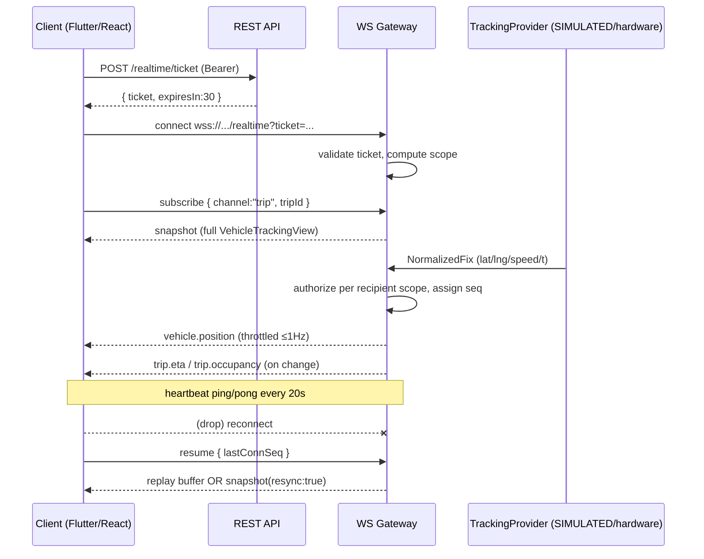

# ViaFast — Real-Time Tracking Contract (WebSocket)

Status: **Proposed contract** (design phase). No backend, no GPS hardware, and no WebSocket server exist yet.
Goal: a **provider-independent** live-tracking channel that works identically whether positions come from today's simulator or tomorrow's (unselected) GPS hardware.
Companion docs: [`domain-model.md`](./domain-model.md), [`api-contract.md`](./api-contract.md), [`data-integrity-audit.md`](./data-integrity-audit.md), [`architecture-decisions.md`](./architecture-decisions.md).

This contract deliberately mirrors the existing, uncommitted `src/tracking/` seam (`TrackingProvider`, `VehicleTracking`, `freshnessForAge`) so the retained React admin and the new Flutter clients can share one live-data vocabulary. **No GPS vendor is chosen and no mapping/location SDK is added in this phase** (ADR‑001, ADR‑014).

---

## 1. Design principles

1. **Provider abstraction is server-side.** The backend defines a `TrackingProvider` port with one operation: *produce normalized fixes*. Implementations: `SimulatedTrackingProvider` (now) and a future `HardwareTrackingProvider` (vendor undecided). Clients never learn which is active. The wire schema below is the **only** thing clients see.
2. **Server pushes normalized views, not raw device payloads.** Clients receive the `VehicleTrackingView` projection (domain-model §5.3), never vendor-specific telemetry.
3. **Authorization is enforced per event, per connection.** A client only ever receives frames for vehicles/trips it may see (§5). Scoping is computed server-side from the authenticated principal — never from a client-supplied filter alone.
4. **Freshness is derived, not trusted.** The server stamps each fix; staleness/offline is computed from age using fixed thresholds (§4).
5. **Recoverable.** Every frame carries a monotonic `seq` per vehicle so a reconnecting client can detect and backfill gaps (§7).

---

## 2. Transport & connection lifecycle

- Protocol: **WebSocket** over TLS (`wss://`), subprotocol `viafast.v1`. Host from environment config (never hardcoded).
- JSON text frames. One event object per frame (no batching except the initial snapshot).
- **Heartbeat:** server sends `ping` every 20s; client must `pong`. 3 missed pongs ⇒ server closes with `1001`. Client-side, 25s without any frame ⇒ consider the socket suspect and reconnect.
- **Connection close codes:** `4001` unauthorized (bad/expired token), `4003` forbidden scope, `4429` rate-limited, `1001` going away.
- Max payload 64 KB. Max 1 concurrent connection per user per client type (extra connections may evict the oldest).

### 2.1 Authentication (handshake)
- The browser `WebSocket` API cannot set headers reliably, and mobile clients rotate tokens; therefore authenticate via **short-lived ticket**, not the access token in the URL:
  1. Client calls `POST /api/v1/realtime/ticket` (Bearer access token) → `{ "ticket": "rt_...", "expiresIn": 30 }`.
  2. Client connects to `wss://<host>/api/v1/realtime?ticket=rt_...`.
  3. Server validates the ticket (single-use, 30s TTL), derives the principal, computes the authorization scope, and admits or closes with `4001`.
- The ticket binds the connection to a `userId` + role + scope snapshot. Token refresh during a long-lived session is handled by re-issuing a ticket and reconnecting (§7.3).
- **Authorization is re-evaluated** when the server-side scope changes (e.g. a driver's trip ends, a guardian link is removed) — the server sends `scope.changed` and may drop now-unauthorized streams.

---

## 3. Envelope

Every server→client frame:

```json
{
  "event": "vehicle.position",
  "seq": 48213,
  "vehicleId": "01J9VEH...",
  "tripId": "01J9TRIP...",
  "sentAt": "2026-10-11T07:15:20.400Z",
  "data": { /* event-specific */ }
}
```

- `event` — dotted type (catalogue §6).
- `seq` — **monotonic per `vehicleId`** for telemetry ordering/gap detection; non-telemetry events use a per-connection counter in `connSeq`.
- `sentAt` — server emit time (ISO‑8601 UTC).
- Every frame also carries `connSeq` (integer, per connection, strictly increasing) used for reconnect replay (§7).

Client→server frames (subscriptions/acks):

```json
{ "action": "subscribe", "channel": "trip", "tripId": "01J9TRIP..." }
{ "action": "unsubscribe", "channel": "trip", "tripId": "01J9TRIP..." }
{ "action": "ack", "connSeq": 48120 }
```

---

## 4. Freshness & staleness (authoritative thresholds)

Carried over verbatim from `src/tracking/geo.ts` so the simulator and future hardware behave identically:

| State | Condition (`age = now − deviceRecordedAt`) |
|---|---|
| `LIVE` | `age < 20s` |
| `STALE` | `20s ≤ age < 60s` |
| `OFFLINE` | `age ≥ 60s` |

- Freshness is **computed by the consumer** from `deviceRecordedAt` and its own clock (the existing hook overlays it client-side); the server also includes a computed `freshness` hint per fix using server time.
- **Stale behaviour:** when a vehicle goes `STALE`, clients keep showing the last known position but must render the `STALE` indicator (existing `FRESHNESS_META`). No new `vehicle.position` frames arrive while the feed is down.
- **Offline behaviour:** at `OFFLINE`, the server emits a single `vehicle.freshness` = `OFFLINE` transition (edge-triggered, not every tick) and stops position frames for that vehicle. On recovery it emits `LIVE` and resumes. A trip that is `COMPLETED` is never marked `OFFLINE` (existing hook rule: `freshness===OFFLINE && status!==COMPLETED`).
- **Delayed/out-of-order fixes:** a real device may upload a backlog after reconnecting. The server accepts fixes with `deviceRecordedAt` in the past, orders them by `(vehicleId, seq)`, and **does not** emit a `LIVE` position older than the last emitted one; late fixes older than the newest are persisted for history but suppressed on the live channel (they'd cause the marker to jump backwards). `serverReceivedAt` vs `deviceRecordedAt` divergence is recorded for audit (domain-model §5.1).

---

## 5. Authorization & subscription scopes (who sees what)

Scope is computed from the principal at handshake; a client may only `subscribe` within it. Subscribing outside scope ⇒ `4003` close or an `error` frame.

| Principal | Receivable channels | Scope rule |
|---|---|---|
| **STUDENT** | `trip` for the trip(s) serving their **active** `RideAssignment`'s route | Server derives `tripId` from the assignment; student cannot subscribe to an arbitrary trip |
| **PARENT/GUARDIAN** | `trip` for trips serving **each linked child's** route (via `StudentGuardian.canTrack=true`) | Union over linked children; auto-updates when links change (`scope.changed`) |
| **DRIVER** | `trip` **only** for the trip where `Trip.driverId == caller`; plus own `boarding`/`incident` acks | Strictly their assigned operational context; no fleet visibility |
| **ADMIN** | `fleet` (all active trips), any `trip`, `incident`, `notification` | Fleet-wide, subject to `read:fleet` permission |
| **STAFF** | `trip` for the trip serving their active staff ride (if any) | Like STUDENT |

- **Students/parents receive tracking only for authorized vehicles/trips.** A guardian linked to a child on Route 2 never sees Route 3 telemetry.
- **Drivers are limited to their assigned trip** — never other buses, never fleet occupancy.
- The server **re-checks** scope on every subscription and re-derives it when underlying data changes; authorization is not a one-time handshake decision.
- Channels:
  - `fleet` — ADMIN only; all active-trip vehicles.
  - `trip:<tripId>` — position/status/eta/occupancy/boarding for one trip.
  - `incident` — ADMIN (all), DRIVER (own trip only).
  - `notification` — targeted per §6.6 audience rules.

---

## 6. Event catalogue

### 6.1 `vehicle.position` (telemetry — the GPS event)
Emitted on each accepted fix (throttled to ≤ 1 Hz per vehicle; the simulator ticks per its interval). `data`:

```json
{
  "vehicleId": "01J9VEH...",
  "tripId": "01J9TRIP...",
  "routeId": "01J9ROUTE...",
  "position": { "latitude": 30.2020, "longitude": 71.4725 },
  "speedKmh": 31,
  "headingDeg": 84.0,
  "accuracyM": 8.5,
  "deviceRecordedAt": "2026-10-11T07:15:20.000Z",
  "serverReceivedAt": "2026-10-11T07:15:20.310Z",
  "freshness": "LIVE",
  "provider": "SIMULATED",
  "progress": {
    "currentStopSequence": 6,
    "nextStop": { "id": "01J9STOP...", "sequence": 7, "name": "Nowan Sheher Chowk" },
    "stopsRemaining": 10,
    "totalStops": 17,
    "progressPercent": 38
  }
}
```

- `provider` is informational only (e.g. `SIMULATED`); clients must not branch behaviour on it. This is the single field that reveals the source, and it is safe to expose.
- `headingDeg`/`accuracyM`/`altitudeM` are **optional** — the simulator omits them; real hardware may include them. Clients must tolerate absence (existing `GeoPoint` had only lat/lng).
- `progress` is derived by projecting the fix onto the ordered stop list (domain-model §4.2). It is a convenience, not truth.

### 6.2 `vehicle.freshness` (edge-triggered state change)
`data`: `{ "vehicleId", "tripId", "freshness": "STALE" | "OFFLINE" | "LIVE", "ageMs": 61000, "lastKnownPosition": {...} }`. Emitted only on transition (§4), so clients can flip the indicator without polling.

### 6.3 `trip.status`
`data`: `{ "tripId", "routeId", "vehicleId", "status": "BOARDING" | "IN_PROGRESS" | "COMPLETED" | "CANCELLED", "delayMinutes": 8, "changedAt": "..." }`. Emitted on lifecycle transitions (from `POST /me/trip/status` or system). Sent to all in-scope subscribers of that trip; `CANCELLED` also triggers a `notification.created` to affected riders.

### 6.4 `trip.eta`
`data` mirrors the ETA engine output (domain-model §5.2 / existing `calculateSmartETA`):
```json
{
  "tripId": "01J9TRIP...",
  "targetStopId": "01J9STOP...",
  "etaMinutes": 12,
  "confidencePercent": 84,
  "distanceRemainingKm": 6.4,
  "trafficLevel": "MODERATE",
  "algorithmVersion": "eta-v1",
  "computedAt": "2026-10-11T07:15:20Z"
}
```
- Emitted at most every ~15s per trip, or immediately on a material change (delay spike, status change). Per-rider ETAs (to *their* pickup/drop stop) are computed by passing `targetStopId`; a client needing a stop-specific ETA requests it via REST (`/me/ride`) or a `subscribe` with `targetStopId`.

### 6.5 `trip.occupancy` and `boarding.updated`
- `trip.occupancy`: `{ "tripId", "registeredCount": 27, "onboardCount": 12, "capacity": 30, "percent": 40 }`. **Computed**, emitted on change (boarding event) or every ~30s. Note the two distinct counts (domain-model §5) — `registeredCount` (bookings) must not be shown as "on board".
- `boarding.updated`: `{ "tripId", "studentId", "event": "BOARDED", "stopId", "journeyStatusNow": "ON_BOARD", "occurredAt" }`. Scoped: the assigned DRIVER, ADMIN, and the **guardians/student of that rider only**. A guardian receives `boarding.updated` solely for their linked children. Drives the parent "boarded safely" alert (existing `handleUpdateStudentStatus` notification).

### 6.6 `incident.*` and `notification.created`
- `incident.created` / `incident.updated`: `{ "incidentId", "tripId", "vehicleId", "type", "severity", "status", "message" }`. To ADMIN (all) and the assigned DRIVER (own trip). Not broadcast to students/parents directly; a guardian-facing message goes out as a `notification.created` if warranted.
- `notification.created`: `{ "id", "type", "severity", "title", "body", "refs": { "tripId"?, "routeId"?, "studentId"? }, "createdAt" }`. Delivered to the resolved audience: broadcast `audienceRole` matches, **or** structured `refs` the recipient is authorized for (e.g. a `studentId` ref reaches that student and their guardians). Read state is per-user (REST `/me/notifications/{id}/read`), not on the frame.

### 6.7 `scope.changed`
`data`: `{ "reason": "GUARDIAN_LINK_REMOVED" | "TRIP_ENDED" | "ASSIGNMENT_CHANGED", "added": ["trip:..."], "removed": ["trip:..."] }`. Tells the client its authorized channel set changed; the client must drop removed streams. Keeps long-lived sockets honest as data changes.

### 6.8 `error`
`data`: `{ "code": "FORBIDDEN_SCOPE" | "BAD_FRAME" | "RATE_LIMITED", "message": "..." }`. Non-fatal unless accompanied by a close code.

### 6.9 `snapshot` (on subscribe)
Immediately after a successful `subscribe` (or reconnect), the server sends one `snapshot` frame with the current full state for the channel so the client does not wait for the next delta:
`data`: `{ "channel": "trip", "tripId": "...", "vehicle": { /* full VehicleTrackingView */ } }` or `{ "channel":"fleet", "vehicles":[ /* VehicleTrackingView[] */ ] }`.

---

## 7. Reconnection & missed-event recovery

### 7.1 Gap detection
- The client tracks the highest `connSeq` received. Frames are strictly increasing per connection.
- On any gap (missing `connSeq`) or socket close, the client reconnects (§7.2) and requests replay.

### 7.2 Resume protocol
1. Client re-authenticates (new ticket if the old access token expired) and connects.
2. Client sends: `{ "action": "resume", "lastConnSeq": 48120, "subscriptions": [ {"channel":"trip","tripId":"..."} ] }`.
3. Server behaviour:
   - If `lastConnSeq` is within the **replay buffer** (default: last 500 frames or 5 minutes per user), it replays the missed frames in order, then resumes live. Client sees no gap.
   - If `lastConnSeq` is too old / unknown (buffer overflowed, long offline), the server sends a fresh `snapshot` per subscription and resumes live (`resync: true`). The client should treat its prior state as stale and rebuild from the snapshot.
4. Telemetry ordering across a gap is reconciled by `(vehicleId, seq)`: after a `snapshot`, the client discards any buffered position frame with `seq ≤` the snapshot's `seq`.

### 7.3 Token expiry mid-session
- Access tokens are short-lived; a WS connection outlives them. Before expiry the client fetches a new ticket and reconnects with `resume` (§7.2) to avoid a visible drop. The server closes with `4001` if the bound principal can no longer be validated.

### 7.4 Back-pressure & throttling
- Per-vehicle position emission is throttled (≤ 1 Hz). If a client is slow to read, the server drops **older telemetry** (position frames are safe to drop) but never drops `trip.status`, `boarding.updated`, `incident.*`, or `notification.created` (these are queued up to a cap, then force a `resync`).
- Client should render position at its own cadence and never assume a fixed tick (the simulator's interval varies with `simulationSpeed`; real hardware cadence is undecided).

---

## 8. Provider abstraction (server-side) — no vendor lock-in

```
interface TrackingProvider {          // port (mirrors src/tracking/types.ts)
  readonly kind: string;              // "SIMULATED" | "<vendor>"
  start(sink: (fix: NormalizedFix) => void): void;
  stop(): void;
}
```
- `NormalizedFix` = the fields of `vehicle.position.data` (§6.1). Both the simulator and any future hardware adapter emit **exactly this shape**; the WS layer, authorization, persistence (`LocationUpdate`), and ETA engine are provider-agnostic.
- Selecting the provider is a **server config** choice (env), invisible to clients beyond the informational `provider` string.
- **This phase does not select hardware, add a mapping SDK, or add a location package.** The abstraction exists so that when a device is chosen, only a new `TrackingProvider` implementation is written — no client or schema change (ADR‑001, ADR‑014).

---

## 9. Simulation vs production (explicit)

- Today the only provider is `SIMULATED`, reproducing the existing in-app movement loop (`App.tsx` advances `currentStopIndex`/`currentLat`/`currentLng` toward the next stop). It emits the same frames real hardware will.
- **Nothing here implies a live GPS feed exists.** The client must display the dev/simulated nature where appropriate (the Flutter welcome screen already shows a "Dev build — no backend" indicator). When real hardware lands, the same frames flow with `provider` set accordingly and no client change.
- Freshness thresholds (§4) are the same in both modes, so STALE/OFFLINE behaviour is exercised by the simulator (it can intentionally age fixes) before hardware exists.

---

## 10. Sequence / timing summary



See [`domain-model.md`](./domain-model.md) §5 for the persisted telemetry/ETA entities and [`api-contract.md`](./api-contract.md) §7–8 for the REST writes that trigger `trip.status` / `boarding.updated`.
